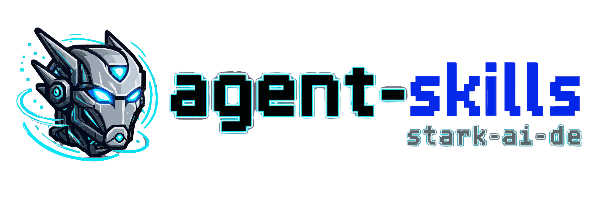

<picture>
  <source media="(max-width: 600px) and (prefers-color-scheme: light)" srcset="./assets/generated/galaxy-header-mobile-light.svg">
  <source media="(max-width: 600px)" srcset="./assets/generated/galaxy-header-mobile.svg">
  <source media="(prefers-color-scheme: light)" srcset="./assets/generated/galaxy-header-light.svg">
  
</picture>

I’m Marcel, an entrepreneur and builder from Stuttgart. I co-founded **servrox solutions** in 2021 and run our software consultancy. With **stark AI**, I’m focused on AI agents and harness engineering.

**TypeScript** is my default across the stack. My search for the right Web3 tools took me from IOTA to **Aptos**, still one of my favourite stacks, and to co-building Panana Predictions.

Previously: Web3 Topic Lead at Porsche Digital and CIO at HAVN Labs, where we raised **$1M pre-seed**. I started in software engineering at CENIT and consulting at EXXETA.

### Agent Skills

Reviewed workflows for Codex, Claude Code and Cursor, built from our daily engineering work.

  

  
  

**[Repository](https://github.com/stark-ai-de/agent-skills)** · **[Browse the catalog](https://stark-ai-de.github.io/agent-skills/)** · **[ChatGPT plugin](https://chatgpt.com/plugins/plugins_6a85d98a7bc48191879aedd91610271e)**

- **[Jev Capability Advisor](https://stark-ai-de.github.io/agent-skills/skills/jev-capability-advisor/)** — Find suitable skills and MCP tools for the task.
- **[Architecture Compass](https://stark-ai-de.github.io/agent-skills/skills/architecture-compass/)** — Hand-curated ADR guidance for architecture decisions.
- **[Codex Spec Interviewer](https://stark-ai-de.github.io/agent-skills/skills/codex-spec-interviewer/)** — Turn fuzzy requirements into implementation-ready specs.
- **[CodeGraph + ast-grep](https://stark-ai-de.github.io/agent-skills/skills/codegraph-ast-grep/)** — Explore code relationships and find structural patterns.

### stark AI

Practical AI systems, agents and engineering workflows.

  <a href="https://github.com/stark-ai-de">
    <picture>
      <source media="(prefers-color-scheme: dark)" srcset="./assets/brands/stark-ai-dark.svg">
      
    </picture>
  </a>

[GitHub](https://github.com/stark-ai-de) · [Website](https://stark-ai.de/en)

### servrox solutions

The software consultancy I co-founded in 2021.

  <a href="https://github.com/servrox-solutions">
    <picture>
      <source media="(prefers-color-scheme: dark)" srcset="./assets/brands/servrox-dark.svg">
      
    </picture>
  </a>

[Explore servrox solutions on GitHub](https://github.com/servrox-solutions)

### Panana Predictions

An on-chain prediction market on Aptos. **DeFi/RWA winner at Aptos Code Collision 2024.**

  

[Explore Panana Predictions](https://panana.fun/)

**Also built:** [ConsoleFX](https://github.com/servrox/console-fx) · [1337 Turbo Starter](https://github.com/servrox/1337-turbo-starter)

  
<b>Toolkit & activity</b>

<picture>
  <source media="(max-width: 600px) and (prefers-color-scheme: light)" srcset="./assets/generated/tech-stack-mobile-light.svg">
  <source media="(max-width: 600px)" srcset="./assets/generated/tech-stack-mobile.svg">
  <source media="(prefers-color-scheme: light)" srcset="./assets/generated/tech-stack-light.svg">
  
</picture>

  <picture>
    <source media="(max-width: 600px) and (prefers-color-scheme: light)" srcset="./assets/generated/stats-card-mobile-light.svg">
    <source media="(max-width: 600px)" srcset="./assets/generated/stats-card-mobile.svg">
    <source media="(prefers-color-scheme: light)" srcset="./assets/generated/stats-card-light.svg">
    
  </picture>

[LinkedIn](https://www.linkedin.com/in/servrox/) · [Website](https://servrox.solutions/)

Each star represents a public repository; its glow reflects its stargazers. Built with <a href="https://github.com/vinimlo/galaxy-profile">Galaxy Profile</a>. The sky refreshes twice a day.
